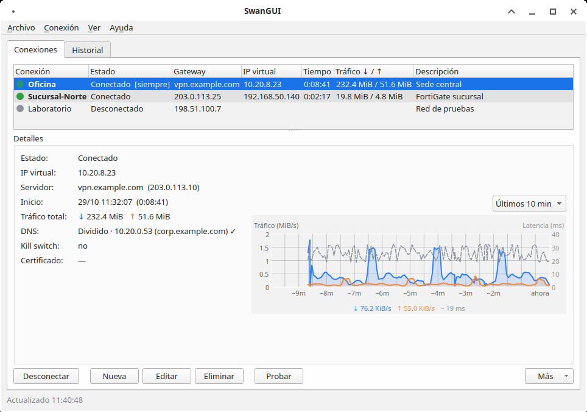
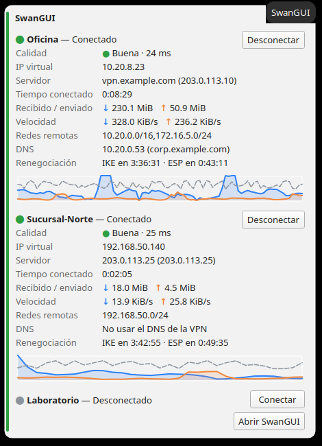
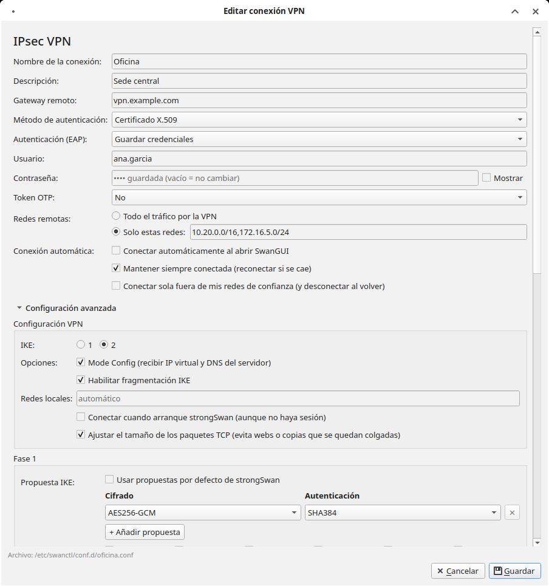
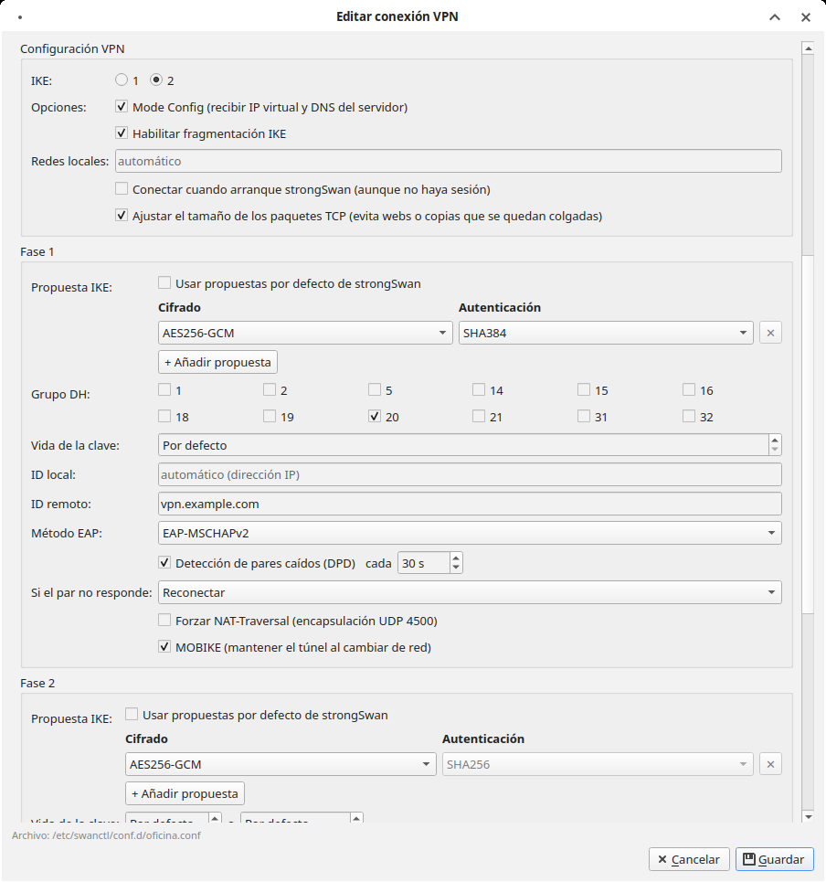
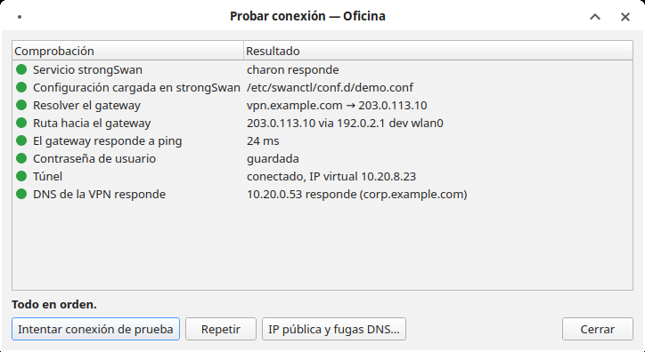
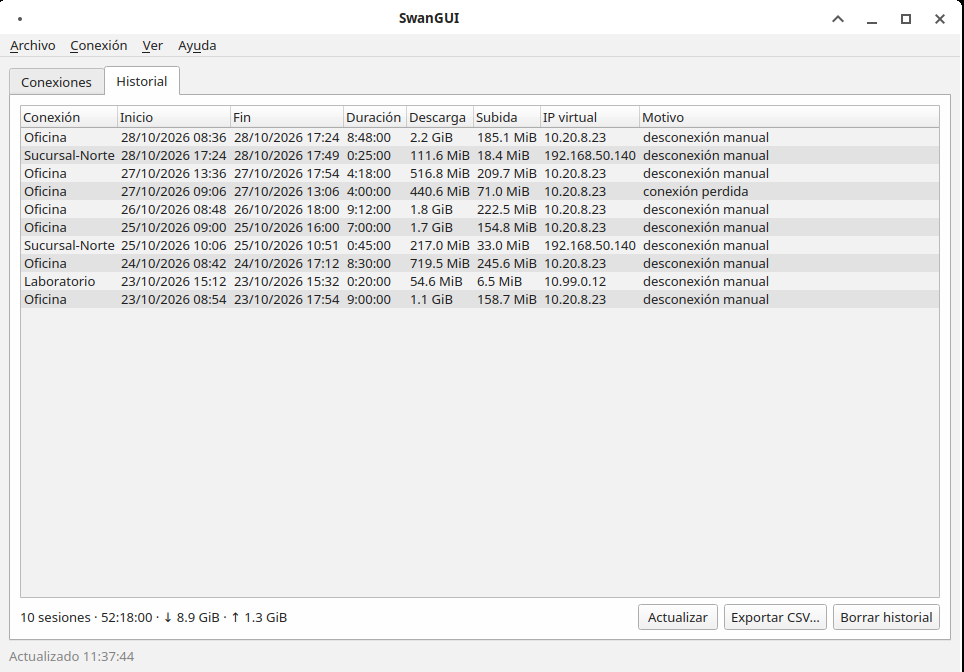
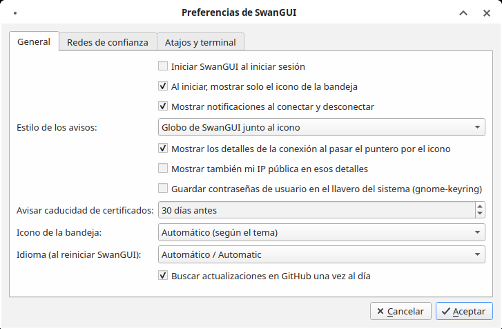

<p align="center"></p>

<h1 align="center">SwanGUI</h1>

<p align="center"><b>Tus VPN IPsec de strongSwan, a un clic desde la bandeja — como FortiClient, pero libre y para Linux.</b><br>
<i>Your strongSwan IPsec VPNs one click away in the tray — like FortiClient, but free and for Linux.</i> · <a href="#english">English below</a></p>

<p align="center">


</p>

**SwanGUI es un cliente VPN IPsec gráfico para Linux.** Usa [strongSwan](https://www.strongswan.org/)
(`swanctl` / charon) por debajo y le pone encima lo que normalmente solo tienen los clientes
comerciales: una ventana para crear y editar conexiones sin tocar archivos de configuración, un
icono en la bandeja para conectar y desconectar, gráfica de tráfico y latencia en vivo, DNS dividido,
kill switch, reconexión automática, diagnóstico guiado e importación desde FortiClient, MikroTik,
pfSense, Windows, Cisco y Apple. Sirve para conectarse a FortiGate, pfSense/OPNsense, MikroTik,
Windows RRAS, Cisco o cualquier servidor strongSwan.

Funciona en Arch, CachyOS, Manjaro, Debian, Ubuntu y Fedora, en cualquier escritorio con bandeja del
sistema (XFCE, KDE Plasma, Cinnamon, MATE, GNOME con la extensión AppIndicator…).

<p align="center"></p>

## Capturas

| Tarjeta al pasar el puntero por el icono | Editor de conexión (estilo FortiClient) |
|---|---|
|  |  |
| **Fase 1 y Fase 2** | **Diagnóstico guiado** |
|  |  |
| **Historial de conexiones** | **Preferencias** |
|  |  |

*Capturas hechas con conexiones de ejemplo y tráfico simulado (dominios `example.com` e IP de
documentación 203.0.113.0/24, 198.51.100.0/24); no muestran ninguna red ni credencial real.*

## Funciones

- **Conexiones IPsec** IKEv1 (main/aggressive + XAuth) e IKEv2 (PSK, certificados, EAP): crear, editar, duplicar, borrar, conectar y desconectar desde la bandeja.
- **Configuración como FortiClient**: gateway, método de autenticación, usuario/contraseña, Fase 1 y Fase 2 en tablas de cifrado/autenticación, DH, DPD, PFS, NAT‑T, MOBIKE, fragmentación…
- **Plantillas** para FortiGate, pfSense/OPNsense, MikroTik, Windows RRAS, Cisco y strongSwan.
- **Importar / exportar** (con o sin contraseñas, y **cifrado con contraseña**): FortiClient, strongSwan (swanctl), MikroTik RouterOS, pfSense/OPNsense, Windows (PowerShell), Cisco IOS, Apple (.mobileconfig) y strongSwan Android (.sswan).
- **DNS dividido** con systemd-resolved: solo los dominios de la empresa van al DNS de la VPN, el resto sigue en tu DNS local. Comprueba que el DNS de la VPN responde antes de usarlo.
- **Kill switch** (nftables) que también cubre contenedores y máquinas virtuales.
- **Siempre conectada**, conexión automática al arrancar o fuera de tus **redes de confianza**, reconexión al **despertar el equipo** y espera ante **portales cautivos**.
- **Diagnóstico** guiado, prueba de **IP pública y fugas DNS**, registro filtrable, historial y gráfica de tráfico.
- Contraseñas en el **llavero del sistema** (opcional), **OTP / FortiToken**, aviso de **caducidad de certificados**, atajos globales y línea de comandos (`swangui connect NOMBRE`).
- Interfaz en **español e inglés**.

## Seguridad

SwanGUI separa la interfaz (tu usuario) de un pequeño *helper* que corre como root mediante **polkit**:

| Operación | Autorización |
|---|---|
| Ver estado, conectar, desconectar, diagnosticar | sin contraseña (administradores en sesión local activa) |
| Crear, editar, borrar, importar, editor de texto, exportar **con** contraseñas | **contraseña de administrador** (se recuerda unos minutos) |

- El helper valida todo lo que recibe: no acepta `updown`, `include` ni rutas fuera de `/etc/swanctl`, y rechaza nombres y caracteres peligrosos.
- Cada operación sensible queda registrada en el journal (`journalctl -t swangui-helper`); nunca se registran contraseñas.
- Las contraseñas de un solo uso viajan por stdin, nunca en la línea de comandos.
- Los archivos de SwanGUI en tu carpeta personal son privados (0600) y el canal de control solo acepta a tu usuario.

Si encuentras un problema de seguridad, consulta [SECURITY.md](SECURITY.md).

## Qué usa y para qué

SwanGUI no reemplaza a strongSwan: es la interfaz. Los paquetes `.deb`, `.rpm` y de Arch instalan
todo esto automáticamente.

| Componente | Para qué lo usa SwanGUI | Arch | Debian / Ubuntu | Fedora |
|---|---|---|---|---|
| **strongSwan** (`swanctl`, charon-systemd) | El motor IPsec: negocia y mantiene los túneles | `strongswan` | `strongswan-swanctl`, `charon-systemd` | `strongswan` |
| **Python 3.10+ y PyQt6** | La interfaz gráfica y el icono de la bandeja | `python`, `python-pyqt6` | `python3`, `python3-pyqt6` | `python3`, `python3-pyqt6` |
| **polkit** + agente de autenticación | Ejecutar el *helper* como root (`pkexec`) con las reglas de abajo | `polkit`, `polkit-gnome` | `polkitd` | `polkit` |
| **nftables** | Kill switch y ajuste del MSS de TCP dentro del túnel | `nftables` | `nftables` | `nftables` |
| **iproute2** | Rutas e interfaz para el DNS de la VPN | `iproute2` | `iproute2` | `iproute` |
| **systemd-resolved** | DNS dividido (solo los dominios de la empresa van al DNS de la VPN) | `systemd` | `systemd-resolved` (opcional, SwanGUI ofrece instalarlo) | `systemd-resolved` |
| **NetworkManager** (`nmcli`) | Redes de confianza y detección de portales cautivos | `networkmanager` | `network-manager` | `NetworkManager` |
| **libsecret** (`secret-tool`) | Guardar contraseñas en el llavero (GNOME Keyring, KWallet…), opcional | `libsecret` | `libsecret-tools` | `libsecret` |
| **python-cryptography** | Exportaciones cifradas con contraseña (scrypt + AES-256-GCM) | `python-cryptography` | `python3-cryptography` | `python3-cryptography` |
| **OpenSSL** | Leer certificados y avisar antes de que caduquen | `openssl` | `openssl` | `openssl` |
| **iputils** (`ping`) | Latencia en la gráfica y en el diagnóstico | `iputils` | `iputils-ping` | `iputils` |

## Instalación

Descarga el paquete de tu distribución desde la [última versión](https://github.com/FrankMncrf/SwanGUI/releases/latest):

| Distribución | Paquete |
|---|---|
| Debian 12+ / Ubuntu 24.04+ | [swangui_1.0.9-1_all.deb](https://github.com/FrankMncrf/SwanGUI/releases/download/v1.0.9/swangui_1.0.9-1_all.deb) |
| Fedora | [swangui-1.0.9-1.fc44.noarch.rpm](https://github.com/FrankMncrf/SwanGUI/releases/download/v1.0.9/swangui-1.0.9-1.fc44.noarch.rpm) |
| Arch Linux, CachyOS, Manjaro, EndeavourOS | [swangui-1.0.9-1-any.pkg.tar.zst](https://github.com/FrankMncrf/SwanGUI/releases/download/v1.0.9/swangui-1.0.9-1-any.pkg.tar.zst) · [PKGBUILD](https://github.com/FrankMncrf/SwanGUI/releases/download/v1.0.9/PKGBUILD) |
| Sumas de verificación | [SHA256SUMS](https://github.com/FrankMncrf/SwanGUI/releases/download/v1.0.9/SHA256SUMS) |

### Debian / Ubuntu

```sh
sudo apt install ./swangui_1.0.9-1_all.deb
```

### Fedora

```sh
sudo dnf install ./swangui-1.0.9-1.fc44.noarch.rpm
```

### Arch Linux y derivadas

```sh
sudo pacman -U swangui-1.0.9-1-any.pkg.tar.zst
```

O constrúyelo tú con el `PKGBUILD`: `makepkg -si`. Pronto también en AUR (`yay -S swangui`).

### Desde el código

```sh
git clone https://github.com/FrankMncrf/SwanGUI.git && cd SwanGUI
./install.sh            # instala en /usr/local (pide sudo)
```

**Requisitos:** los de la tabla [Qué usa y para qué](#qué-usa-y-para-qué). En Debian systemd-resolved no viene de serie y, si lo instalas, pasa a gestionar el DNS de todo el sistema; por eso SwanGUI pregunta antes de instalarlo la primera vez que una conexión usa el DNS de la VPN. Si respondes que no, la VPN funciona igual, pero los nombres internos no se resuelven.

## Uso

Abre **SwanGUI** desde el menú de aplicaciones. El icono del escudo en la bandeja indica el estado (verde conectado, ámbar conectando, rojo error o kill switch bloqueando). Clic derecho para conectar o desconectar. Al dejar el puntero sobre el icono aparece una tarjeta con los detalles de cada conexión: calidad, IP virtual, tiempo conectado, tráfico, velocidad, DNS y renegociación, con botones para conectar o desconectar.

```text
swangui status | list | connect NOMBRE | disconnect NOMBRE | toggle NOMBRE
```

## Contribuir

Reporta errores y sugerencias en [Issues](https://github.com/FrankMncrf/SwanGUI/issues) o [Discussions](https://github.com/FrankMncrf/SwanGUI/discussions) (también desde *Ayuda → Reportar un error*). Las pruebas se ejecutan con `make test`.

## Apoyar el proyecto

Si SwanGUI te resulta útil, puedes apoyarlo (también desde *Ayuda → Donar*):

- ☕ [Buy Me a Coffee](https://buymeacoffee.com/frankmncrf)
- ₿ Bitcoin: `bc1qm45kpx35uazdts3q8vc77edqwyajuxe9cexw0er5409dyevl3nysxhln9g`
- ⭐ Una estrella en GitHub también ayuda.

## Licencia

GPL-3.0-or-later. Consulta [LICENSE](LICENSE).

---

## English

**SwanGUI is a graphical IPsec VPN client for Linux, in the style of FortiClient.** It runs on top
of [strongSwan](https://www.strongswan.org/) (`swanctl` / charon) and adds what usually only
commercial clients have: a window to create and edit connections without touching config files, a
tray icon to connect and disconnect, a live traffic and latency graph, split DNS, a kill switch,
auto-reconnect, guided diagnostics, and import/export for FortiClient, MikroTik, pfSense, Windows,
Cisco and Apple. Use it to connect to FortiGate, pfSense/OPNsense, MikroTik, Windows RRAS, Cisco or
any strongSwan server. See the screenshots above (taken with made-up connections and simulated
traffic).

**Features:** IKEv1 (main/aggressive + XAuth) and IKEv2 (PSK, certificates, EAP); FortiClient-like
editor with Phase 1 / Phase 2 proposal tables, DH groups, DPD, PFS, NAT-T, MOBIKE and fragmentation;
vendor templates; split DNS through systemd-resolved (with a liveness check of the VPN DNS); an
nftables kill switch that also covers containers and VMs; always-on connections, trusted networks,
reconnect after suspend and captive portal awareness; a hover card on the tray icon with live
details for every tunnel; traffic/latency graph and connection history; diagnostics and a public
IP / DNS leak test; keyring storage, OTP / FortiToken, certificate expiry warnings, global shortcuts
and a CLI (`swangui connect NAME`). Import/export formats: FortiClient, strongSwan swanctl, MikroTik
RouterOS, pfSense/OPNsense, Windows PowerShell, Cisco IOS, Apple .mobileconfig and strongSwan for
Android (.sswan), optionally **password-encrypted** (scrypt + AES-256-GCM).

**What it uses:** strongSwan (the IPsec engine), Python 3.10+ and PyQt6 (the GUI), polkit (to run
the root helper), nftables (kill switch, TCP MSS clamping), iproute2, systemd-resolved (split DNS),
NetworkManager (trusted networks, captive portals), libsecret (keyring, optional),
python-cryptography (encrypted exports), OpenSSL (certificate expiry) and iputils (latency). The
packages pull in all of them; see the [table above](#qué-usa-y-para-qué) for package names per
distro.

**Security:** privileged work goes through a small helper started with **pkexec**: routine
operations (status, connect, disconnect, diagnose) need no password, while anything that changes the
configuration or can reveal secrets requires the administrator password. The helper validates every
input and logs sensitive operations to the journal, never passwords.

**Install:** packages for Debian/Ubuntu (`.deb`), Fedora (`.rpm`) and Arch (`.pkg.tar.zst`,
`PKGBUILD`) are on the [releases page](https://github.com/FrankMncrf/SwanGUI/releases/latest); see
the table above. AUR coming soon. The interface follows your locale (Spanish or English) and can be
changed in Preferences.
